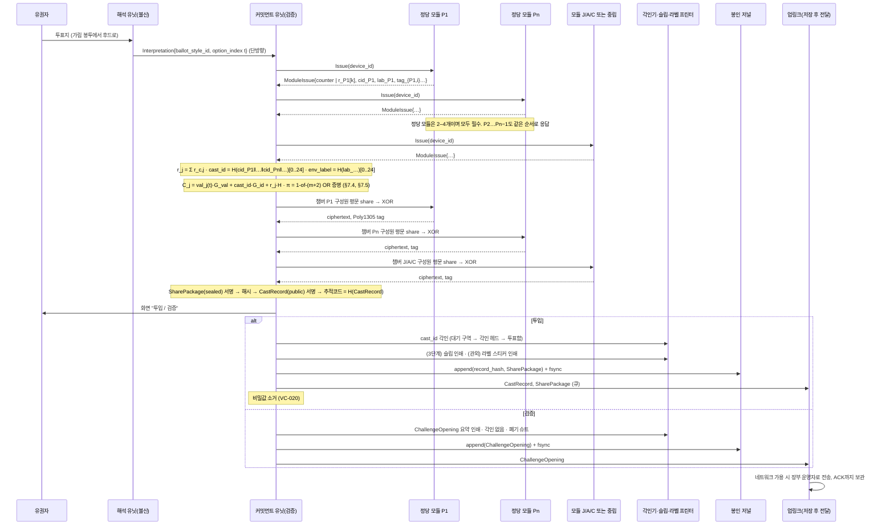
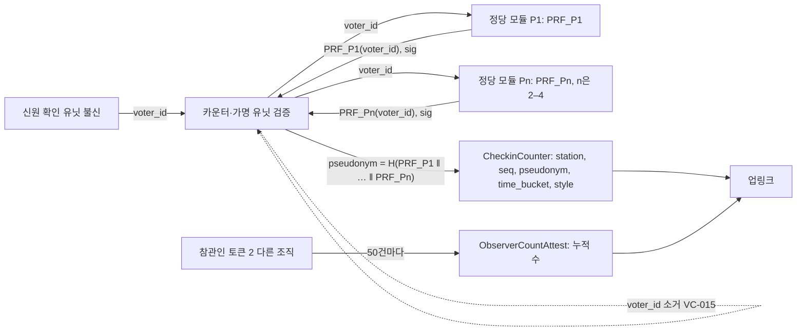
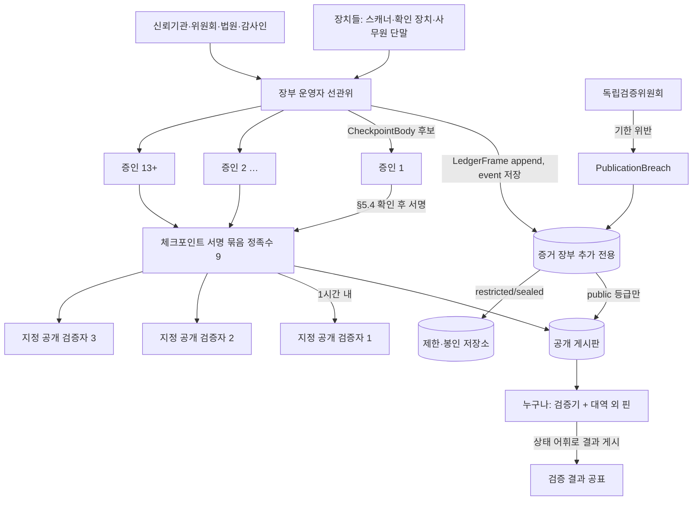
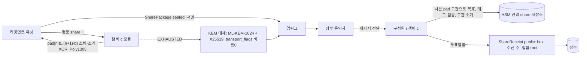
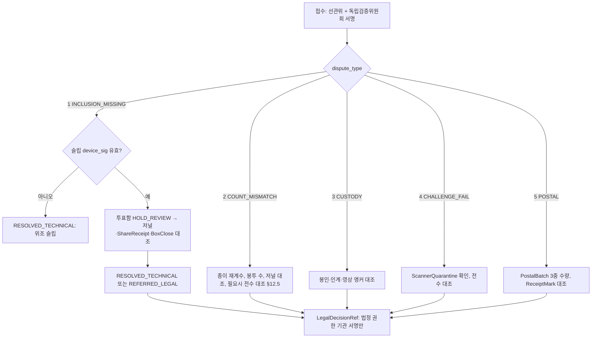
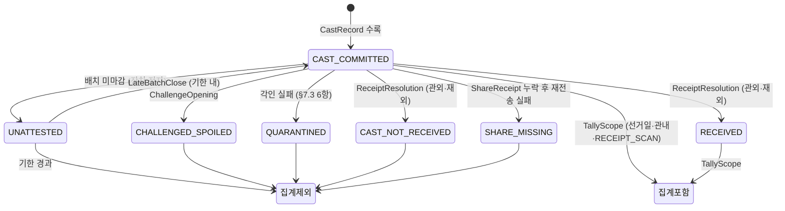
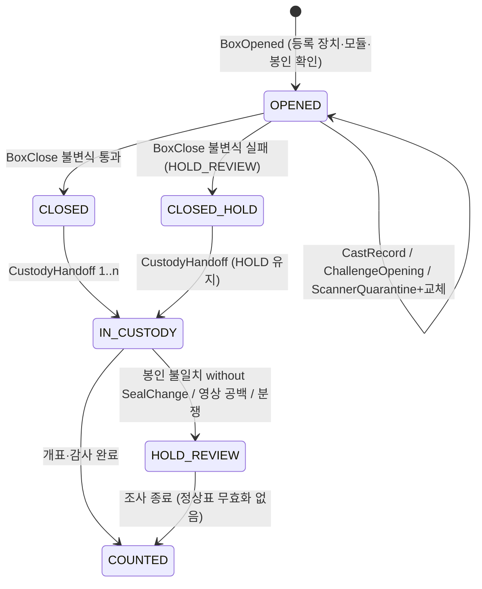
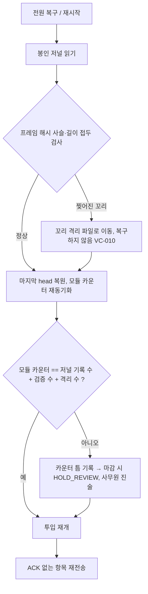
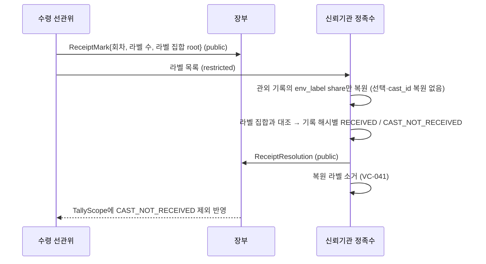
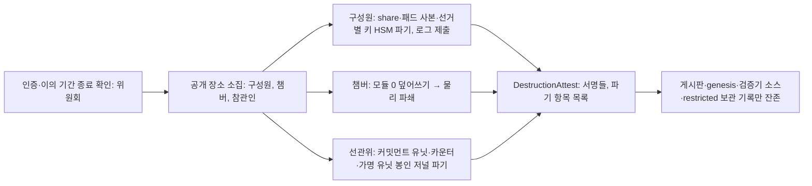

# 처리 흐름 / Processing Flows

> English summary: Data flows and state machines of ityv, consistent with PROTOCOL.md section numbers and event names: the split casting scanner (interpretation unit, commitment unit, chamber modules, imprinter, sealed journal, store-and-forward uplink), the check-in device, ledger, board, checkpoints, witnesses and public verifiers, share transport with one-time pads and KEM fallback, aggregate-only tally, record-first audit, disputes, all state machines, size and throughput estimates, and a table of what is logged at which visibility class. Diagrams are Mermaid blocks plus SVG files in this folder.

규범은 `docs/spec/PROTOCOL.md`(§ 인용)다. 사람의 행동 순서는 `docs/usecases/USE_CASES.md`, 종이의 모양은 `docs/ballot/BALLOT_LAYOUT.md`에 있다. 바이트 형식은 `docs/spec/ENCODING.md`.

## 1. 투함 스캐너 데이터 흐름 (§7, `scanner_dataflow.svg`)



핵심 규칙:
- 해석 유닛 → 커밋먼트 유닛 링크는 물리적으로 단방향이며 메시지는 `Interpretation` 하나뿐이다(§7.1). 이미지는 커밋먼트 유닛에 도달하지 않는다.
- 기록 본문 해시에 장치와 각 모듈이 Ed25519로 즉시 서명하고(§7.2.1), 모듈 응답의 공개부(`counter`)는 `CastRecord`에, 비공개부(`r_c`, `cid_c`, `lab_c`, 태그)는 패드 암호화된 `SharePackage`에만 들어간다(§7.2). 모듈과 장치의 서명은 기록마다가 아니라 64건 배치의 `BatchAttest`에 붙으며, 모듈은 자기 카운터 구간이 틈 없이 일치할 때만 서명한다(§7.2.1, VC-021, VC-053).
- 패드 XOR는 모듈 안에서 한다. 커밋먼트 유닛과 선관위 부품에는 패드가 없다(VC-035).
- `SharePackage`의 해시가 먼저 확정되고 `CastRecord`가 그것을 참조한다(§7.3 5항). 패키지를 바꿔치기하면 공개 기록과 어긋난다(VC-032).
- 각인은 "투입" 결정 뒤 대기 구역을 지나며 이루어진다. 검증 시에는 각인이 없다(§8).
- 업링크는 저장 후 전달이다. 네트워크가 없어도 투표·마감은 진행되고, 기록은 ACK까지 봉인 저널에 남는다(§9.4.4).

## 2. 확인 장치 흐름 (§6)



- `voter_id`는 모듈 두 곳과 카운터·가명 유닛에만 순간적으로 존재하고 어디에도 저장되지 않는다(VC-015, §6.4).
- 투표소별 순번과 15분 구간만 기록되며, 투함 기록에는 시간이 없으므로 순번·구간과 투함 기록을 잇는 열쇠가 존재하지 않는다(VC-001, VC-019).
- 선거 후 공개되는 것은 투표소별 가명의 **정렬된 다중집합**뿐이다(§6.5).

## 3. 장부, 게시판, 체크포인트, 증인, 공개 검증자 (§5, §14, `ledger_board_flow.svg`)



검증기 수행 순서는 §14의 1–9다. 어느 미러에서 받았든 게시판 사본은 신뢰 대상이 아니고 핀과 서명만이 근거다(§4.2).

## 4. share 전송, 수신, 영수 (§9.3, §9.4, §9.6)



- 수신 대조(VC-036): 누구나 `BoxClose.record_count`와 모든 구성원의 `ShareReceipt` 수를 비교한다. 부족하면 봉인 저널에서 재전송한다.
- 패드 고갈 시 대체 경로 사용은 공개 기록의 플래그로 드러난다(§9.4.5).

## 5. 집계 흐름 (§11)

```mermaid
flowchart TB
    SC[TallyScope: 투표양식별 포함 집합 root, 제외 목록+사유] --> SUM
    subgraph 신뢰기관 정족수 정당 챔버 전부와 J·A·C·N 중 셋 이상
      SUM[각 구성원: 포함 기록 share 합산] --> REC[선형 복원: R_j = Σ r_j, S = Σ cast_id]
    end
    REC --> AO[AggregateOpening: style, j, T_j, R_j, S, 서명들]
    AO --> CHK{"C_total,j == T_j·G_val + S·G_id + R_j·H ?"}
    CHK -->|예| DEC[26비트 자릿수 해독 → 인덱스별 표 수, 자릿수 ≤ 교부 수 VC-024]
    CHK -->|아니오| BIS[투표함 부분합 이분 탐색 → 기록 단위 → 결함 장치 특정, 열린 기록 수 공개 §11.3]
    DEC --> ST[CRYPTO_TALLY_VERIFIED 또는 HOLD_REVIEW]
```

- 청크 `j`마다 별도 등식이며, 인덱스 0(BLANK)과 m+1(UNREADABLE)도 자릿수로 나온다. 법적 유효성 판정은 사람이 한다(§7.4, §11.4).
- `S`는 무작위 투함 ID의 합이며 어떤 정보도 담지 않는다.

## 6. 감사 흐름 (§12)

```mermaid
flowchart LR
    F[AuditManifestFreeze: 포함 집합 root, 규칙] --> D[주사위 의식 영상 해시]
    D --> S[AuditSeed = H(dice ‖ beacon ‖ final checkpoint)]
    B[공개 난수 비콘 회차] --> S
    C[최종 체크포인트 해시] --> S
    S --> SAM[SHAKE256 스트림 → 포함 기록 인덱스 표본, 누구나 재계산 VC-046]
    SAM --> OPEN[정족수: SampleOpening (t, cast_id, r_j) 비공개 열람, 공개는 해시]
    OPEN --> FIND[감사인 2조직: 투표함 개봉, cast_id 판독으로 종이 찾기]
    FIND --> CMP[SampleComparison 일치/불일치]
    CMP -->|임계 이하| PA[PAPER_AUDITED]
    CMP -->|임계 초과| EXP[표본 확대 → 전체 수검표, AuditFinding]
    SAM --> SUB[은닉 채널 표본 2%: 기록당 챔버 하나의 기여만 복원, 모듈 태그 검증 §9.5]
```

## 7. 분쟁 흐름 (§13)



"내 표 내용이 다르다"는 주장은 입구에서 접수되지 않는다(§13 3항).

## 8. 상태기계 (`cast_record_states.svg`)

### 8.1 투함 기록

제외는 모두 기록 해시와 사유로 공개된다(VC-042). `UNATTESTED`에서 `CAST_COMMITTED`로의 복귀(늦은 마감)만 예외이고 다른 상태는 되돌아가지 않는다. 경우별 상세는 `docs/spec/FAILURE_CASES.md`. `SHARE_MISSING`은 종이는 있으나 전자 기록을 열 수 없는 경우이며 종이 계수에는 포함된다.

### 8.2 투표함

마감 후 새 `CastRecord`는 거부된다(VC-039). `CLOSED`에서 `OPENED`로 돌아가는 전이는 없다.

### 8.3 보관(용기 단위)
`SEALED → TRANSIT → RECEIVED → STORED → OPENED_FOR_COUNT`. 각 전이는 `CustodyHandoff`(송신·수신 다른 조직, §10.3)이고, 봉인 변경은 `SealChange`가 선행해야 한다. 우편 회차는 `PostalBatch` 3중 수량이 맞을 때만 `RECEIVED`로 간다(§10.5).

### 8.4 체크포인트
`PROPOSED → (증인별 §5.4 확인) → SIGNED(9+) → PUBLISHED(검증자 3곳 수신) → ARCHIVED(SLH-DSA 추가)`. 같은 `checkpoint_seq`의 다른 본문은 어떤 증인도 서명하지 않는다(VC-013).

### 8.5 상태 어휘 사다리 (검증기 출력, §14)
```
UNVERIFIED
  → LOG_CONSISTENT            (§14 1–5 통과)
  → SOURCE_COMPLETENESS_CHECKED (예상 투표함 전부 마감 1:1)
  → CRYPTO_TALLY_VERIFIED     (TallyScope·AggregateOpening 등식)
  → PAPER_AUDITED             (SampleComparison 규칙상 종료)
  → LEGAL_CERTIFIED           (LegalDecisionRef 참조 표시만, 검증기가 판정하지 않음)
어느 단계에서든 실패·미해결 분쟁 → HOLD_REVIEW
```
상태는 서로 바꿔 표시할 수 없고 자동 전환되지 않는다(VC-050).

## 9. 크기와 처리량 추정

가정: 대통령 선거(후보 14, 인덱스 16 → 청크 k=2), 정당 챔버 2개, 모듈 3개(P1, P2, 중립), 챔버당 구성원 3명(챔버 6개, 18명), 전국 투함 기록 4,400만. 서명 크기: ML-DSA-87 4,627B, Ed25519 64B, SLH-DSA-SHAKE-256s 29,792B.

### 9.1 공개 기록 1건
| 필드 | 바이트 | 비고 |
|---|---|---|
| 헤더·ID·플래그 | ≈ 230 | `election_id`, `box_id`, `ballot_style_id`, 해시 64 |
| 커밋먼트 k=2 | 64 | |
| 정형성 증명 (m+2)(k+2) 스칼라 | 2,048 | 16 × 4 × 32 |
| 모듈 카운터 3개 | ≈ 60 | ID·카운터만 |
| 기록 서명 (장치 + 모듈 3) Ed25519 | 256 | 즉시 공개, 고전 공격자에 대한 출처 증명 |
| **기록 합계** | **≈ 2.7 KB** | |
| `BatchAttest` 분담분 | ≈ 300 | (모듈 3 + 장치 1) × 4,691B ÷ 64건, 본문 포함 |
| **표당 합계** | **≈ 3.0 KB** | 모듈 5개면 ≈ 3.3 KB |

전국: 44M × 3.0KB ≈ **130 GB**. 정형성 증명이 75%를 차지한다. 국회의원 지역구(후보 6, k=1)는 증명 768B로 표당 ≈ 1.4KB, 비례대표(정당 35, k=5)는 증명 8,288B로 표당 ≈ 8.9KB. PROTOCOL v0.1 §7.2.1이 기록마다 Ed25519, 배치마다 하이브리드 서명 구조를 규범으로 채택했다(ADR-0014). 표마다 하이브리드 서명을 붙이는 설계는 표당 ≈ 21KB, 전국 ≈ 930GB가 되어 기각했다.

### 9.2 봉인 패키지와 패드
| 항목 | 바이트/기록/구성원 | 비고 |
|---|---|---|
| share 스칼라 (3모듈 × 2청크 + cast_id + env_label) | 256 | 선거일·관내는 env_label 없이 224 |
| `cid_c`, `lab_c` (자기 챔버) | 48 | |
| 모듈 태그 | 16 | |
| Poly1305 태그, ID, 패드 인덱스 | ≈ 56 | |
| **패키지 항목** | **≈ 376** | 18명 × 376 ≈ 6.8 KB/기록 |
| **패드 소비 b** | **384** | 평문 320 + MAC 키 32 + 모듈 태그 키 32 |

정당 챔버가 넷이면 모듈 5개(P1–P4, 중립)에 구성원 24명이다. share 스칼라 384B, 평문 448B, 패드 소비 b = 512, 패키지 ≈ 24 × 504B ≈ 12.1KB/기록이고, 공개 기록은 §9.1의 모듈 5개 기준 표당 ≈ 3.3KB다.

투표함 최대 2,500표 기준 구성원당 패드 0.96MB, 챔버당 3명이면 모듈당 2.9MB, `N_max` 2배 적용 시 5.8MB. 구성원 한 명이 전국 분을 보관하면 44M × 376B ≈ 16.5GB.

### 9.3 처리량
| 구간 | 추정 | 근거 |
|---|---|---|
| 커밋먼트 유닛, 표 1건 | < 1초 | OR 증명 ≈ 70 스칼라곱(Cortex-M4급 ≈ 100ms), 슬립 서명(3단계) ≈ 150ms, 모듈 I/O·XOR·인쇄. 배치 서명은 64건마다 |
| 투표소 처리 간격 | 10–15초/표 | 현행 투입 속도와 같음. 병목은 장치가 아니라 유권자 동선 |
| 공개 검증기, 기록 1건 | 2–4ms | OR 증명 재계산 ≈ 70 스칼라곱(x86 멀티스칼라 ≈ 2ms), 배치 서명 검증은 64건당 4회 |
| 전국 전수 검증 | 60–120 코어시간 | 64코어 기관 검증자 1–2시간. 시민 검증기는 표본·합계 검증 |
| 합계 열기 | 분 단위 | 선형 share 합 44M × 8 스칼라 덧셈, 구성원별 병렬 |
| 감사 표본 종이 찾기 | 투표함당 수 분 | 투표지 전수 판독 2,500장, 판독기 20장/초 |

### 9.4 게시판 공표 지연
체크포인트 1시간 이내 전달(§5.5), 투표 종료 후 24시간 이내 전체 공표. 투표소 업링크는 저장 후 전달이므로 마감 후 수 시간의 지연이 정상이다. 지연 자체는 상태 `UNVERIFIED`로만 보인다.

## 10. 무엇이 어디에 기록되는가

| 데이터 | public(게시판) | restricted(참관인·감사인·법원) | sealed(신뢰기관·법원) | 어디에도 없음 |
|---|---|---|---|---|
| 커밋먼트, 정형성 증명, 모듈 카운터, 장치 서명 | ✔ | | | |
| 선택 `t`, `r_j`, `cast_id`(투함 기록 안) | | | share로 분산 | 평문 어디에도 없음 |
| `ChallengeOpening`(폐기된 표의 선택) | ✔ | | | |
| 추적코드 | ✔(기록 해시) | | | 유권자와의 연결 |
| 가명 다중집합 | ✔(선거 후, 정렬) | | | 가명↔투함 기록 |
| `voter_id` | | | | 소거(VC-015) |
| 확인 순번·15분 구간 | ✔ | | | |
| 봉인 저널(투함 순서) | | | ✔ (파기 의식까지) | |
| `SharePackage` | 해시만 | | ✔ | |
| 봉투 라벨 목록 | root·수 | ✔ | ✔(대조 의식 중) | 공개 기록 |
| 영상 원본·대응표 | 구간 해시 | ✔ | | |
| 교부 회계표 원본 | 수량만(마감) | ✔ | | |
| 분쟁 증거 원본 | 해시 | ✔ | | |
| 패드, 선거별 비밀키 | | | 구성원·모듈 | 게시·해시 모두 금지(VC-033) |
| 감사 표본의 선택·`cast_id` | ✔ | | | 유권자와의 연결 |

## 11. 단계별 활성 흐름

| 단계 | 활성 흐름 | 비활성 |
|---|---|---|
| 0 | §3 장부·체크포인트, §2의 수량 부분(참관인 카운터만), 보관·우편·영상(§8.3) | §1, §4, §5, §6, 가명 |
| 1 | + 신뢰기관 DKG·임명·모듈 발급 의식 | §1 기록 생성 |
| 2 | + §1(슬립 제외), §4, §5, §6, 가명, 수령 대조 | 슬립 |
| 3 | + 슬립, 포함 분쟁(§7) | — |

## 12. 커밋먼트 유닛의 복구 흐름 (§5.1, §7.8)



- 재시작 중 모듈에서 발급받았으나 저널에 기록되지 않은 난수는 카운터 틈으로 남는다. 틈은 숨길 수 없고 마감 불변식이 잡는다(VC-021, VC-038).
- 각인 후 저널 기록 전에 전원이 끊기면 종이 1장이 기록 없이 함에 있을 수 있다. 이는 마감 시 `paper_count ≠ record_count`로 드러나며 `HOLD_REVIEW`다(`USE_CASES.md` O).

## 13. 모듈 발급과 보관 흐름 (§9.4.2, §10.1)

```mermaid
flowchart LR
    MF[모듈 제작] --> CER[발급 의식: 위원회 주관, 참관인 입회]
    CER -->|모듈 내부 TRNG| PAD[구성원별 패드 생성]
    PAD -->|유선 1회 복사| MEM[구성원 보관 장치 HSM]
    CER --> EV[ModuleProvisioned: 모듈 ID, 장치 ID, 챔버, 구성원 수, 패드 길이]
    CER --> SEAL[봉인 → 챔버 → 위원회 물류 → 투표소]
    SEAL --> CH[CustodyHandoff 사슬 (다른 조직 쌍방 서명)]
    CH --> BO[BoxOpened: 봉인 번호·모듈 ID를 genesis와 대조]
    BO -->|불일치| DQ[개시 거부, DisputeEvent 3 CUSTODY]
```

패드 값이나 해시는 어떤 이벤트에도 들어가지 않는다(VC-033). 모듈은 발급 후 어떤 패드도 외부로 내보내지 않으며, 사용한 구간은 즉시 소거한다(VC-034).

## 14. 관외 수령 대조 의식 (§10.6)



봉투 수령 후 개봉은 회차 단위 분리·혼합 뒤에만 이루어지며, 라벨과 투표지를 함께 기록하는 행위는 금지된다(§10.6 3항).

## 15. 파기 의식 흐름 (§15)



파기 뒤에는 어떤 정족수도 개별 표를 열 수 없다. 게시판은 커밋먼트와 증명만 담으므로 영구 보존해도 무해하다(§16).

## 16. 시험용 투표지와 제외 처리

시험용 투표양식의 기록은 `CastRecord.ballot_style_id`로 식별되어 `TallyScope`에서 `TEST_BALLOT` 사유로 제외된다. 시험 확인(`CheckinCounter`)은 시험용 투표소 ID로 수록되어 가명 다중집합에서 제외된다. 제외 목록과 사유는 공개된다(VC-042). 종이 형식은 `BALLOT_LAYOUT.md` §11.
